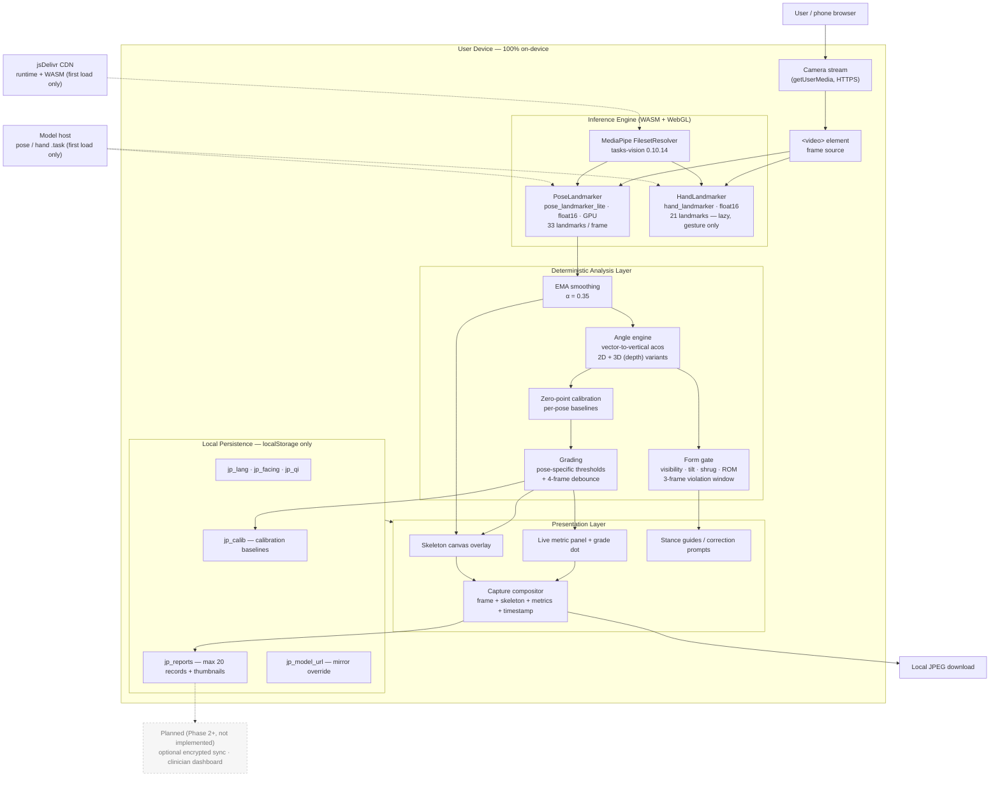

# SpineCare AI — Project Proposal

**Competition Submission · Phase 1 (Concept & Proof of Concept)**

Repository: [github.com/cc3114/spinecare-ai-demo](https://github.com/cc3114/spinecare-ai-demo)  
Live demo: [cc3114.github.io/spinecare-ai-demo](https://cc3114.github.io/spinecare-ai-demo/)

---

## 1. Executive Summary

> ### *Measure your spine in 60 seconds. No hardware. No upload. No clinic visit.*

**SpineCare AI turns any smartphone browser into a posture-screening and corrective-exercise coach.** It runs a 33-landmark pose model entirely on-device, grades shoulder tilt, forward head, and forward-bend asymmetry against clinical-style thresholds, then guides five corrective exercises with form-gated rep counting. Nothing is uploaded — not a single video frame.

|                      |                                                                                                                                         |
| -------------------- | --------------------------------------------------------------------------------------------------------------------------------------- |
| **Who it serves**    | Parents screening school-age children, desk-bound knowledge workers, and home-rehab patients between clinic visits                      |
| **Technology**       | MediaPipe Pose Landmarker (float16, 33 landmarks) via WASM/WebGL in the browser; no framework, no backend, single HTML file             |
| **Core pain solved** | Posture problems are visible but unmeasured — professional screening is expensive, episodic, and hardware-dependent                     |
| **Current stage**    | Working proof of concept: 3 screening poses, 5 guided exercises, photo evidence, local history, bilingual UI                            |
| **Codebase**         | [`cc3114/spinecare-ai-demo`](https://github.com/cc3114/spinecare-ai-demo) — 1,567 lines, one `index.html`, zero dependencies to install |

---

## 2. Problem Statement

### 2.1 The gap between "posture matters" and "posture is measured"

Spinal and postural problems develop slowly and silently. Adolescents with idiopathic scoliosis are typically asymptomatic until curvature is pronounced; desk workers accumulate forward-head and rounded-shoulder posture over years of screen time; post-surgical and conservative-rehab patients lose the feedback loop the moment they leave the clinic.

In all three cases the failure is the same: **posture is judged by feel, not by number.** A parent cannot tell whether a child's shoulders are 2° or 8° uneven. A remote worker has no idea their head has drifted 15° forward. A rehab patient performing daily exercises at home has no way to know whether their form has degraded since last week.

### 2.2 Why existing solutions fall short

| Existing approach | Fatal flaw |
| --- | --- |
| **Posture braces / 矫姿带** | Passive support with **no measurement at all**. It holds the body in position, creates dependency on the device, leaves the underlying muscle imbalance unaddressed, and produces zero data — the user never learns whether they improved. |
| **Wearable sensors (IMU patches, smart clothing)** | **Expensive and shallow.** Hundreds of dollars per user, plus charging and adherence burden, and the sensing is orientation-only: a single-point IMU can see trunk inclination but cannot see shoulder asymmetry, head offset, or rib hump. |
| **Generic reminder apps** | **No sensing whatsoever.** Timer-based nagging fires whether the user is slouched or sitting correctly, so the feedback is uncorrelated with actual posture and is ignored within weeks. |
| **Clinic screening / X-ray** | Gold standard but **episodic and expensive**. A full-spine X-ray means a hospital visit and a radiation dose; it yields a precise number a handful of times a year and cannot be repeated weekly to tell whether anything is changing. |
| **Offline scoliosis rehabilitation centres** | **Effective but bounded by four walls.** Sessions are high quality and therapist-supervised, yet they occupy a tiny fraction of the week: cost per session is high, travel and scheduling exclude many families, and — critically — **the feedback loop ends at the clinic door**. Between visits the patient performs exercises alone with no verification of form, no objective record, and no early warning when technique degrades. |

The common thread is not a lack of knowledge about posture — it is the **absence of a cheap, repeatable, objective measurement** at the moments that matter: at home, between visits, every week.

### 2.3 Why now

Three curves crossed in the last few years:

1. **On-device vision became good enough.** Lightweight landmark models (MediaPipe Pose Landmarker, float16, ~5 MB) now run at interactive frame rates inside a mobile browser via WASM + WebGL, with no native app, no GPU server, and no per-inference cost.
2. **The camera is already in everyone's pocket.** The marginal hardware cost of posture screening dropped to zero — no patch, no brace, no dedicated device.
3. **Privacy expectations hardened.** Users and regulators increasingly reject health video leaving the device. On-device inference converts a compliance problem into a product feature.

The result: a screening capability that previously required a clinic visit and a trained observer can now be delivered as a URL.

### 2.4 User personas

**Persona A — The screening parent**  
*Lin, 41, parent of a 12-year-old girl. Notices uneven shoulders in a school photo.*

> "The school does a visual check once a year and just says 'observe'. I don't know if it's getting worse. Booking a specialist means a weekday off, and I can't tell whether her exercises at home are actually being done correctly."

Needs: a repeatable number she can compare month to month; a clear "see a doctor now" signal rather than vague reassurance; something her daughter will actually cooperate with for 60 seconds.

**Persona B — The desk-bound knowledge worker**  
*Chen, 29, software engineer, 9+ hours a day at a laptop, recurring neck tightness.*

> "I know my head is forward. I've bought a brace, I've installed three reminder apps, none lasted two weeks. I want to see whether the numbers change, not be nagged."

Needs: passive, zero-friction check-ins; quantified progress; corrective drills short enough to actually do; zero interest in handing over body video to another app.

---

## 3. Solution & PoC Demo

### 3.1 Product concept: a four-stage closed loop

```
MEASURE  →  GRADE  →  CORRECT  →  TRACK
(3 poses)   (traffic      (5 guided    (photo evidence
            light)        exercises)   + local history)
```

The design principle is **one number, one action**. Every session ends with either a green light and a maintenance drill, or an amber/red flag with the specific exercise that addresses it — never a dashboard the user has to interpret.

### 3.2 Verified PoC capabilities

Everything below is implemented and working in the current repository. No mock screens, no simulated conclusions presented as real.

#### 3.2.1 Three screening poses with pose-specific metrics

| Pose             | Camera position           | Metrics computed from landmarks                                               | Grading thresholds             |
| ---------------- | ------------------------- | ----------------------------------------------------------------------------- | ------------------------------ |
| **Back view**    | Back to camera, full body | Shoulder tilt (°), pelvic tilt (°), head lateral offset (% of shoulder width) | ≥2.5° amber · ≥6° red          |
| **Side view**    | Side-on, natural stance   | Forward-head angle (°), trunk lean (°), plumb offset (% of torso length)      | head ≥12°/20°, trunk ≥10°/15°  |
| **Forward bend** | Back to camera, bent ~90° | Bend angle (°, 3D incl. depth axis), back asymmetry (%), form check           | asymmetry ≥5% amber · ≥10% red |

Angles are computed as vector-to-vertical angles via `acos`, which is mathematically bounded to 0–180° — a deliberate guard against the unbounded readings that naive `atan2` implementations produce.

> **📷 Screenshot to capture (PPT slide: "PoC — Screening")**  
> The back-view screening screen with a person in frame: dark viewfinder, green skeleton overlay, the three metric values top-left of the frame (e.g. `1.3° / 0.0° / 0%`), the green grade dot top-right, the "full body in frame ✓" confirmation, and the left-hand assessment card.  
> File already in repo: `assets/demo-screen.png`

#### 3.2.2 Zero-point calibration

Phone tilt and a child's natural asymmetry contaminate absolute readings. The user saves a baseline for any pose with one tap; all subsequent values are displayed as **relative change** and re-graded against the same thresholds. This is what makes week-over-week comparison meaningful rather than noisy.

> **📷 Screenshot to capture**  
> The screening screen immediately after tapping "⚖️ Zero-calibrate" — capture the confirmation toast and the values re-rendered as relative deltas.

#### 3.2.3 Five corrective exercises with form-gated rep counting

| Exercise                | Stance             | Automated form gate                                                       |
| ----------------------- | ------------------ | ------------------------------------------------------------------------- |
| Arm raise (双手托天)        | Back view          | No shrugging during the lift; tilt and trunk lean within limits           |
| Shoulder release (沉肩静站) | Back view          | Static hold; shrug detection triggers a live correction warning           |
| Back extension (小燕飞)    | Side, prone        | Lift must stay in the 20°–45° therapeutic window; overshoot voids the rep |
| Cat-cow (猫式伸展)          | Side, quadruped    | Head-down → head-up phase transition detection                            |
| Wall angel (靠墙天使)       | Side, back to wall | Arm slide overhead and return; shrugging compensation voids the rep       |

A rep is credited **only if the form stays valid for the entire movement**. Any excursion beyond threshold for 3 consecutive frames voids that rep and surfaces an on-screen correction. Keypoint visibility is also gated, so an occluded limb cannot earn credit. This is the mechanism that separates a form coach from a motion counter — and it directly targets the home-rehab failure mode where patients "do the reps" with degrading technique.

> **📷 Screenshot to capture (PPT slide: "PoC — Training")**  
> The training screen mid-set, showing the rep counter badge (e.g. "2 双手托天 · 次"), the pose name and Qi points, and the left-hand "how to do it" panel with the current exercise's stance and step list.  
> File already in repo: `assets/demo-train.png`

#### 3.2.4 Stance guide before every exercise

Selecting any exercise opens a full-screen guide that states the required camera position in plain language ("Side view · back against a wall") and lists the movement steps. This solves a real-world usability failure: users cannot be assumed to know what "side view" means, and a wrong stance silently invalidates every angle downstream.

> **📷 Screenshot to capture (PPT slide: "PoC — Guidance")**  
> The stance guide card for the wall angel: green badge "Side view · Back against a wall", the exercise title, the numbered requirement list with check marks, and the primary start button.  
> File already in repo: `assets/demo-stance.png`

#### 3.2.5 Hands-free capture with evidence composite

Users cannot hold a phone and stand in a screenshot-worthy posture simultaneously. Two capture paths are implemented: a **3-second countdown** (with an audible-free visual countdown) and an **OK-gesture trigger** — a lazily loaded 21-landmark hand model detects thumb–index pinch plus three extended fingers, held ~0.5 s, with an 8-second cooldown against repeat firing.

The captured image is composited in-canvas: camera frame + skeleton overlay + metric values + pose name + timestamp, then offered as a downloadable JPEG and archived automatically.

> **📷 Screenshot to capture**  
> The post-capture full-screen photo overlay showing the composite image with skeleton and metrics burned in, plus the "Save image / Back to live view" bar. A short GIF of the OK-gesture → 3-2-1 → capture sequence is strongly recommended for the live pitch.


#### 3.2.6 Local measurement history and grade statistics

Every capture is stored in `localStorage` (capped at 20 entries, thumbnails included). The report view shows record count, latest grade, worst grade, and a chronological list with per-record metrics that opens to the full composite image. Storage-quota overflow degrades gracefully to metrics-only records.

> **📷 Screenshot to capture**  
> The "My Report" screen with 3–4 archived records showing different grade colours, plus the three summary statistics at the top.

#### 3.2.7 Operational robustness

| Capability                  | Implementation                                                                                                            |
| --------------------------- | ------------------------------------------------------------------------------------------------------------------------- |
| **Full-body framing check** | Nose and both ankles tested for visibility and frame bounds; live "step back" / "✓ ready" prompt                          |
| **Signal stabilization**    | Exponential smoothing (α = 0.35) on all landmarks; grade changes require 4 consecutive agreeing frames to prevent flicker |
| **Camera switching**        | Front/rear toggle, persisted                                                                                              |
| **Bilingual UI**            | Complete Chinese/English interface, ~96 keys per locale, switchable at runtime                                            |
| **Graceful degradation**    | Simulation mode on camera denial or model-download failure; custom model mirror URL for restricted networks               |
| **Camera-less demo mode**   | `?demo=1` feeds a canvas-animated figure through the real inference pipeline — identical overlay, metrics, and rep gating |

---

## 4. Technical Architecture & Innovation

### 4.1 System architecture and data flow



**Data-flow statement for judges:** the camera stream enters a `<video>` element, frames are consumed by the landmark model in the same browser process, angles are derived in plain JavaScript, and results are rendered and stored locally. **No `fetch`, no XHR, no backend, no analytics SDK, no account.** The only outbound requests in the entire application are the one-time CDN fetch of the MediaPipe runtime and model weights.

### 4.2 Innovation highlights

**① On-device inference as a privacy architecture, not a checkbox.**  
The product has no server to breach and no video to retain. This is not a policy promise — it is the physical absence of a transmission path, verifiable by reading a 1,567-line single file. For a product that asks parents to point a camera at their child's back, this is the difference between a viable product and a non-starter. It also collapses marginal cost to zero: no GPU inference bill, no bandwidth bill, no per-scan pricing pressure.

**② Deterministic, auditable biomechanics instead of a generative black box.**  
Every number on screen traces to a named landmark pair, a vector-to-vertical `acos` computation, and a published threshold. The forward-bend angle deliberately incorporates the depth (z) axis because spinal flexion manifests primarily as depth folding, not lateral displacement. When a judge or a clinician asks "why 6°?", the answer is a line of code, not a model's opinion. This is the opposite of an LLM wrapper: reproducible, explainable, and identical on every run.

**③ Form gating — the part that actually changes outcomes.**  
Motion counters reward movement; rehabilitation requires *correct* movement. The app gates credit on a composite validity check: keypoint visibility, pose-specific tilt limits, shrug compensation, and range-of-motion windows (e.g. back extension must stay within 20°–45°). Violations persist for 3 frames before voiding a rep, which filters sensor jitter while still catching genuine compensation. The thresholds are also stance-aware — shoulder tilt is not evaluated in side view because both shoulders overlap in that projection and the measurement would be meaningless.

**④ Friction engineering: the product is designed to survive week three.**  
Adherence, not accuracy, is the binding constraint on home posture programs. Concretely: zero install (a URL), zero login, one-tap capture, hands-free OK-gesture triggering so the user can stand correctly and still take the photo, a stance guide before every exercise to prevent silent setup errors, and a 20-record history that makes progress visible. The `?demo=1` mode additionally lets the product be demonstrated — to a clinician, an employer, or a judge — with no camera and no subject present.

**⑤ Bounded-math discipline as an engineering value.**  
Angle pipelines are a classic source of silent, catastrophic error. The current implementation uses a vector-angle formulation whose codomain is provably 0–180°, uses unit-consistent radian/degree handling, and has been unit-tested against known geometric configurations (upright 0.0°, 20° lean, 45°/90° flexion). During development this discipline caught and eliminated a double degree-conversion bug that had produced readings in the hundreds of degrees, and an inverted shrug-distance formula that would have permanently blocked rep credit for every real user.

---

## 5. Competitive Advantage

### 5.1 Comparison matrix

| Dimension | **SpineCare AI** | Posture brace | Wearable sensor | Generic health app | Clinic / X-ray | Offline scoliosis rehab centre |
| --- | --- | --- | --- | --- | --- | --- |
| **Cost to the user** | **¥0** — existing phone | ¥100–300, replaced as the child grows | ¥500–2,000 + charging | ¥0 | ¥300–800 per visit + radiation | ¥200–600 per session, 2–3× weekly |
| **Measurement basis** | 33 landmarks → angular metrics | None (passive support) | Orientation only (single-point) | None (timer-based) | Radiographic Cobb angle | Therapist visual/ palpation assessment |
| **What it can actually see** | Shoulder/pelvic tilt, forward head, trunk lean, forward-bend asymmetry | Nothing | Trunk inclination | Nothing | Full spinal geometry | Whole-body movement quality, expert read |
| **Real-time feedback** | Yes — per-frame, with correction prompts | No | Vibration alert only | Reminder only | No (result arrives after the visit) | Yes, but only inside the session |
| **Form verification** | **Yes** — rep credited only if form is valid | N/A | No | No | Clinician observation, in-clinic only | **Best in class, therapist-supervised** |
| **Personalized intervention** | Yes — pose-specific thresholds + 5 matched exercises | Generic | Generic | Generic | Yes, but clinic-bound | **Yes — individualised programme, highest quality** |
| **Continuity between sessions** | **Yes** — every session logged, trend visible | No | App-dependent, cloud-stored | Minimal | Only at visit intervals | **None — the loop ends at the clinic door** |
| **Longitudinal tracking** | Yes — photo + metrics, up to 20 records on-device | No | Partly, cloud-stored | Minimal | Yes, at visit intervals | Therapist notes; adherence unverified |
| **Accessibility / travel** | Anywhere with a phone | Anywhere | Anywhere, with wear burden | Anywhere | Hospital appointment required | Fixed location, weekday slots, travel cost |
| **Privacy** | **Video never leaves the device** | N/A | Varies; often cloud-synced | Often cloud-synced | Hospital records | Clinical records held by provider |
| **Installation / onboarding** | Open a URL, 60 seconds | Wear daily | Pair, charge, calibrate | Sign-up + permissions | Book appointment, wait for slot | Referral, intake assessment, scheduled visits |
| **Regulatory posture** | Wellness / screening aid | Consumer device | Varies | Wellness | Medical device | Licensed clinical service |
| **Screening frequency** | Unlimited, free | N/A | Continuous but shallow | N/A | 1–2× per year at best | 2–3× per week, only while enrolled |

### 5.2 Reading the offline rehab centre column honestly

Offline scoliosis rehabilitation centres are the **strongest clinical competitor** in this matrix, and the proposal does not pretend otherwise: a trained therapist beats any camera on assessment quality, hands-on correction, and programme design. Three of the thirteen dimensions are won outright by the centre — form verification at expert level, individualised intervention quality, and regulatory standing.

But the column exposes a structural weakness that no amount of clinical skill can fix: **the centre owns the session, not the week.** A patient attending three sessions weekly spends roughly 3 hours under supervision and 165 hours unsupervised. During those 165 hours there is no measurement, no form check, and no record — and this is precisely where home programmes fail, silently and invisibly.

That gap defines the product's role. SpineCare AI is **not positioned to replace the rehab centre; it is positioned to extend it into the 165 hours**, with the same three metrics the therapist cares about, captured in 60 seconds, on a device the family already owns. The commercially interesting consequence is that the two are complements rather than substitutes — which is exactly why "clinic-adjacent follow-up" appears as a revenue track in Section 6, sold to the centre rather than against it.

### 5.3 Positioning

**Positioning statement:** SpineCare AI does not compete with X-ray or with a therapist's hands — it competes with *not measuring at all* in the 360 days between visits, and with the 165 unsupervised hours in every week of rehabilitation. It occupies the empty quadrant of **zero hardware cost × real angular measurement × on-device privacy**.

**Honest limitation, stated up front:** a monocular RGB camera has no depth sensor. Rib-hump asymmetry in the forward-bend pose is inferred from landmark displacement (including the model's z estimate), not from true surface topography. The app is therefore a *screening and adherence tool*, not a Cobb-angle substitute — and it says so on screen.

---

## 6. Feasibility & Business Model

### 6.1 Why this is buildable now

- **Zero infrastructure cost at rest.** Static hosting serves the entire product; inference cost per user per session is ¥0. Gross margin is not "high" — it is structurally near-100% on the delivery side.
- **No app-store gatekeeping.** A URL works on iOS and Android today, updates instantly, and can be embedded in a WeChat message, a school notice, or an employer portal.
- **The core is already validated.** Three screening poses, five exercises, form gating, capture, and history are implemented and demonstrable — the remaining work is productization, not invention.
- **Known engineering backlog, not unknown research risk.** See Roadmap; every Phase 2 item is a scoped engineering task.

### 6.2 Go-to-market

**Track A — Consumer freemium (primary, lowest friction)**


| Tier     | Contents                                                                                                                                    | Price hypothesis                  |
| -------- | ------------------------------------------------------------------------------------------------------------------------------------------- | --------------------------------- |
| **Free** | All three screening poses, grade result, 3 exercise modules, 20-record local history                                                        | ¥0                                |
| **Plus** | Full exercise library, PDF/CSV progress export, multi-profile (siblings / family), long-horizon trend view, optional encrypted cloud backup | ¥19–29 / month or ¥128–198 / year |

Conversion lever: the free tier always answers "is it getting worse?" — the paid tier answers "show me the trend over 6 months and hand it to my doctor."

**Track B — B2B employee wellness (EAP)**  
Employers and insurers already buy musculoskeletal-disease prevention because MSD is a leading driver of claims and lost days. Selling a per-seat annual licence (health check-in module + aggregate, anonymized participation reporting) requires no consumer acquisition cost. The on-device architecture is the decisive selling point for HR and legal review: no employee video or health data enters the employer's systems.

**Track C — Clinic-adjacent follow-up**  
Orthopedic and rehabilitation practices lose visibility between visits. A white-labelled version — practice-branded, patient-scoped, with an exportable adherence and measurement log — extends the clinic's care into the home without requiring the clinic to build software. Sold as a per-practice subscription; positioned explicitly as an *adjunct to* clinical care, never a replacement.

**Track D — School screening programs (optional, highest reach)**  
School-based scoliosis screening is mandated or customary in many regions but is performed visually. A URL-based, teacher-supervised 60-second check with a "refer to specialist" flag could materially improve referral precision. This track requires institutional sales and careful ethical framing; it is a Phase 3 candidate, not a Phase 1 claim.

### 6.3 Compliance and risk boundaries

SpineCare AI is positioned as a **daily posture-management and health-assistance tool**. It is **not a medical device**, does not perform diagnosis, does not measure Cobb angle, and does not replace clinical examination or imaging.

The product will not output diagnostic labels, will not recommend treatment, and will not stratify patients into clinical categories. Its on-screen language is limited to screening-style advisories ("within normal range", "worth observing", "consider seeing a specialist"). Every result screen carries a persistent disclaimer directing users to an orthopedic specialist and a full-spine X-ray for definitive evaluation. Data protection obligations are minimized by architecture: measurements and images are stored only in the user's own browser `localStorage`, are never transmitted, and can be cleared by the user at any time. Any future cloud feature will be opt-in, encrypted, and separately consented. Where local regulation treats posture analysis as a regulated medical function, the product scope will be narrowed to fitness/wellness framing rather than expanded.

---

## 7. Roadmap

### Phase 1 — MVP proof of concept ✅ *current stage*

- [x] On-device pose inference (33 landmarks, float16, GPU delegate) in-browser
- [x] Three screening poses with pose-specific metrics and clinical-style thresholds
- [x] Bounded vector-angle engine (2D + 3D depth variant), unit-tested
- [x] Per-pose zero-point calibration with relative-value display
- [x] Full-body framing check and live stance prompts
- [x] Five corrective exercises with form-gated rep counting
- [x] Per-exercise stance guide in plain language
- [x] Countdown capture + OK-gesture capture (21-landmark hand model, lazy-loaded)
- [x] In-canvas evidence composite (frame + skeleton + metrics + timestamp) and JPEG export
- [x] Local measurement history (20 records) with grade statistics
- [x] Complete bilingual UI (zh/en), camera switching, simulation and demo fallbacks

### Phase 2 — Productization and multi-device polish *(1–3 months)*

- [ ] True PWA: web app manifest + service-worker offline caching of runtime and models
- [ ] Multi-profile support (multiple children / family members) with per-profile baselines
- [ ] Longitudinal trend charts (per-metric, per-pose) and PDF/CSV export for clinical conversations
- [ ] Exercise programs: assign a multi-week corrective plan instead of single exercises
- [ ] Threshold tuning from a labelled dataset of real captures; publish sensitivity/specificity against clinician assessment
- [ ] Accessibility and low-end-device performance pass (frame-rate adaptation, reduced-motion mode)
- [ ] Optional spoken/audible cues for visually impaired users and for hands-free sessions

### Phase 3 — Ecosystem and institutional pilots *(6–12 months)*

- [ ] Encrypted, opt-in cloud backup with explicit consent flow
- [ ] Clinician-facing review dashboard (patient-shared, read-only adherence and trend view)
- [ ] Clinic pilot: 1–2 rehabilitation practices, measuring adherence lift and measurement consistency
- [ ] Employer EAP pilot with anonymized aggregate reporting
- [ ] Expanded exercise library with progression levels and regression variants
- [ ] Optional LLM-assisted narrative summaries of a user's own trend data (clearly labelled as generated text, never as diagnosis)
- [ ] Regulatory review in target markets to confirm wellness positioning before any clinical claim is considered

---

## Appendix — Verifiable claims index

| Claim in this proposal                                        | Where to verify                                                                      |
| ------------------------------------------------------------- | ------------------------------------------------------------------------------------ |
| 33-landmark pose model, float16, GPU delegate                 | `index.html` — `PoseLandmarker.createFromOptions`                                    |
| 21-landmark hand model, lazy-loaded for gestures              | `index.html` — gesture toggle handler                                                |
| Pose-specific metrics and thresholds                          | `index.html` — `POSES` configuration                                                 |
| Bounded angle math (`acos`, 0–180°)                           | `index.html` — `angleUp` / `angleUp3`                                                |
| EMA smoothing α = 0.35, 4-frame grade debounce                | `index.html` — `draw()`                                                              |
| Form gating (visibility / tilt / shrug / ROM, 3-frame window) | `index.html` — training block in `draw()`                                            |
| 20-record local history                                       | `index.html` — `addRecord()`                                                         |
| No network transmission of user data                          | Repository-wide: no `fetch` / XHR / analytics calls; only CDN runtime and model URLs |

---

*SpineCare AI is a family screening and posture-management aid. It is not a medical device and does not provide diagnosis. For definitive evaluation, consult an orthopedic specialist and obtain a full-spine X-ray.*
