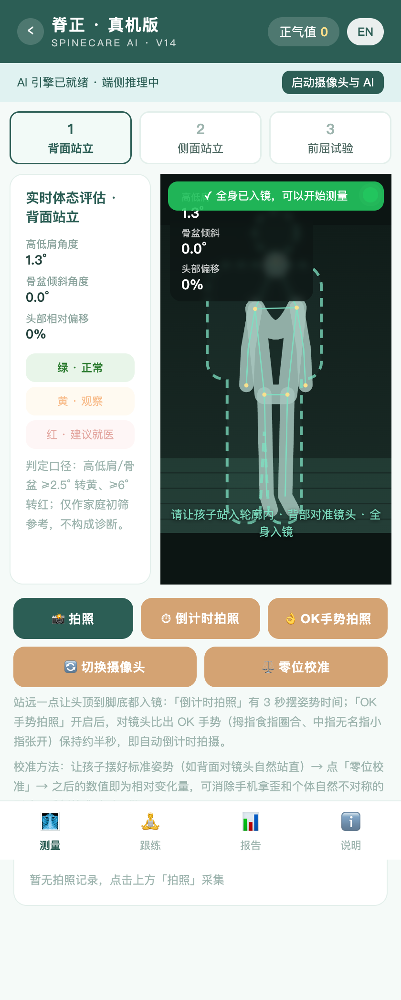
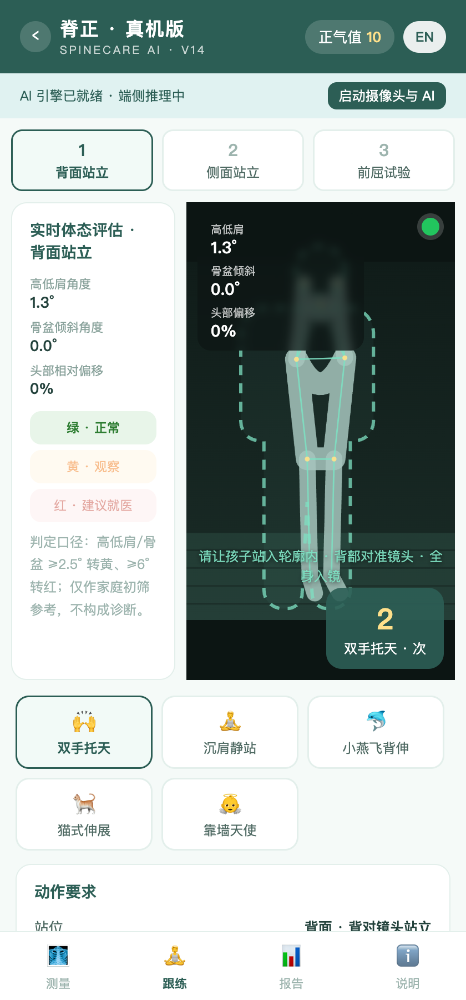
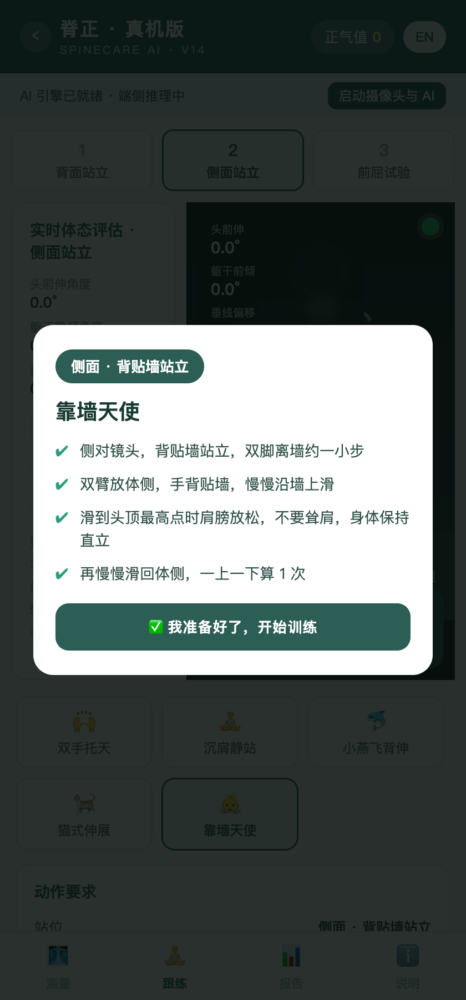

<div align="center">

# SpineCare AI

**An at-home scoliosis and posture screening PWA that runs entirely in the browser — no backend, no uploads, no installation.**

[](https://developer.mozilla.org/en-US/docs/Web/JavaScript)
[](https://developers.google.com/mediapipe)
[](#)
[](./LICENSE)

</div>

---

## Preview / Demo

> Screenshots are placeholders — replace them with your own captures.

| Measurement (back view) | Exercise training | Stance guide |
| :---: | :---: | :---: |
|  |  |  |

**Recommended captures:** the measurement view with the live skeleton overlay and metric panel (back view, green grade dot visible), and the exercise rep counter mid-workout. A short screen recording of the OK-gesture-triggered countdown photo also works well as a GIF.

## Features

- 🩺 **Three screening poses** — back view (shoulder/pelvic tilt, head offset), side view (forward head, trunk lean, plumb offset), and forward-bend test (rib-hump asymmetry), each with amber/red clinical thresholds.
- 📐 **Bounded angle math** — trunk/head/flexion angles are computed with vector-to-vertical `acos`, so results always stay within 0–180°; the forward-bend angle includes the depth (z) axis.
- ⚖️ **Zero-point calibration** — save a baseline for any pose; subsequent readings become relative changes, cancelling out phone tilt and the child's natural asymmetry.
- 🧘 **Form-gated exercise counting** — five exercises (arm raise, shoulder release, back extension, cat-cow, wall angel) only count a rep when the form stays standard for the entire movement (shoulder relaxation, tilt thresholds, range of motion). Violations trigger an on-screen correction warning.
- 📸 **Hands-free capture** — 3-second countdown shooting, plus an OK-gesture trigger detected by a lazily-loaded 21-point hand model (pinch + three extended fingers, held ~0.5 s, with an 8 s cooldown).
- 📊 **Local measurement history** — captures are composited with the skeleton overlay, live metrics, and a timestamp, then archived (max 20 records) with grade statistics. All data stays in `localStorage`.
- 🌐 **Bilingual UI** — full Chinese / English interface, switchable at runtime.
- 🖥️ **Simulation mode** — if the camera or the model download fails, the app falls back to a simulated skeleton so the UI remains explorable (rep counting is disabled there).

## Tech Stack

| Layer | Technology |
| --- | --- |
| Runtime | Plain HTML / CSS / JavaScript (ES modules) — **no framework, no bundler, single file** |
| Pose estimation | [MediaPipe Tasks Vision `0.10.14`](https://www.npmjs.com/package/@mediapipe/tasks-vision) (ESM via jsDelivr, GPU delegate) |
| Pose model | `pose_landmarker_lite` (float16, ~5 MB, 33 landmarks) |
| Hand model | `hand_landmarker` (float16, ~2 MB, 21 landmarks — loaded only when gesture capture is enabled) |
| Storage | Browser `localStorage` (language, calibration, reports, camera facing, custom model URL) |
| Backend | None — all inference is on-device; video frames never leave the browser |

## Quick Start

### Requirements

- A modern browser with WASM + WebGL support (Chrome / Edge / Safari; mobile browsers supported).
- **HTTPS or `localhost`** — browsers only grant camera access in secure contexts, so don't open the file via `file://`.
- Internet access on first launch to fetch the MediaPipe runtime and models (~7 MB total), then cached by the browser.

### Install

```bash
git clone https://github.com/cc3114/spinecare-ai-demo.git
cd spinecare-ai-demo
```

There are **no dependencies to install** — the app is a single `index.html`.

### Configuration

No `.env` file is required. All settings live in the browser's `localStorage`:

| Key | Purpose | Default |
| --- | --- | --- |
| `jp_lang` | UI language (`zh` / `en`) | `zh` |
| `jp_qi` | Accumulated reward points ( +5 per valid rep ) | `0` |
| `jp_calib` | Zero-point calibration baselines per pose | `{}` |
| `jp_facing` | Camera facing (`user` / `environment`) | `user` |
| `jp_model_url` | Custom mirror URL for the pose model (for restricted networks) | *(unset — uses Google's official URL)* |
| `jp_reports` | Measurement history, up to 20 entries with thumbnails | `[]` |

The custom model URL can also be set from the in-app **Info** tab.

### Run

```bash
# Dev (local server; required for camera + WASM)
python3 -m http.server 8000
# then open http://localhost:8000
```

```bash
# Alternative one-liner
npx serve .
```

**Demo mode:** append `?demo=1` to the URL to explore the full UI (skeleton overlay, live metrics, rep counting) without a camera or a person in frame — a canvas-animated figure feeds pre-defined landmarks through the real pipeline. Ideal for screenshots and quick reviews.

**Build:** none. Deploy by serving the directory as-is (static hosting is enough — GitHub Pages, Netlify, nginx, etc.).

## Project Structure

```
spinecare-ai-demo/
├── index.html      # The entire app: markup, styles, and JS (screening, training,
│                   # capture, reports, i18n, MediaPipe integration)
├── .gitignore
├── LICENSE
└── README.md
```

## Roadmap

- [ ] Export measurement history as PDF / CSV
- [ ] Multi-frame averaging to further stabilize angle readings
- [ ] Landmark visualization settings (hide skeleton, custom colors)
- [ ] PWA manifest + offline caching of models
- [ ] More exercise types with per-exercise difficulty tuning

## Disclaimer

This project is a **family screening aid only** and is **not a medical device**. It does not provide a diagnosis. For a definitive evaluation, please consult an orthopedic specialist and take a full-spine X-ray.

## License

Distributed under the [MIT License](./LICENSE).
